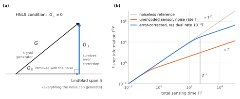
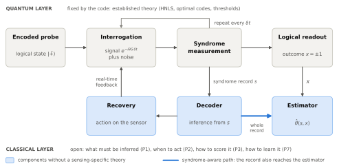
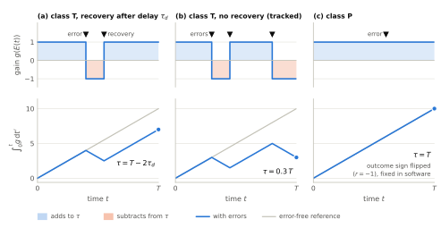
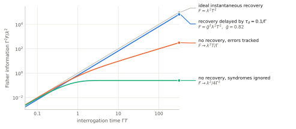
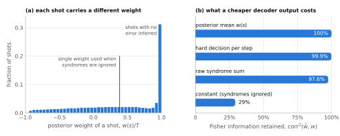
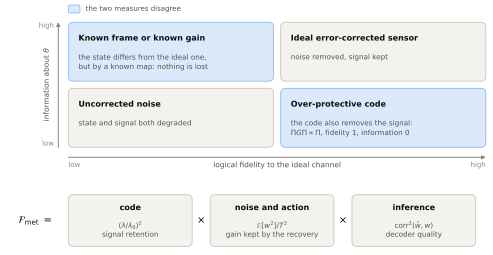
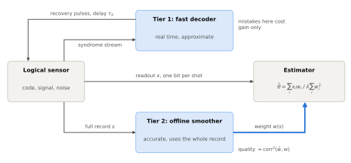
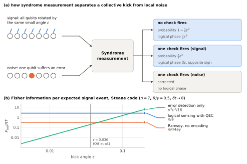
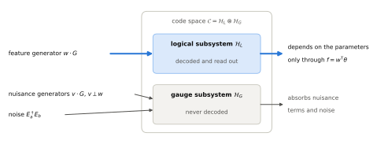

# Quantum Error Correction for Quantum Sensing: Gap Analysis and Research Proposals

*Prepared 12 November 2026. Literature status as of that date.*

## 0. Summary of conclusions

1. **The question is important and timely.** Decoherence reduces entanglement-enhanced sensors from the Heisenberg limit to the standard quantum limit; quantum error correction (QEC) is the only known general mechanism that restores the Heisenberg limit under Markovian noise. Logical qubits now exist in hardware, and in 2026 alone at least six papers moved the field from "does a suitable code exist?" to "how is a logical sensor operated?".
2. **Where the gap is.** Existing theory fixes the *code* and assumes ideal, instantaneous, complete recovery. What is still borrowed unchanged from quantum computing is the layer between the syndrome record and the estimate: the **decoder**, the **recovery policy**, and the **figures of merit**. No general theory states what a decoder must output for a sensing task, what an imperfect or slow decoder costs, or how a logical sensor should be benchmarked.
3. **Your first idea is correct, and can be sharpened.** A recovery never increases the information already acquired; its only function is to keep the future signal accumulating coherently. Consequently the object that must be *right* is the classical inference of a low-dimensional statistic of the error history, whereas the operation that is physically *applied* may be cheap, late, or wrong. Under stated assumptions I derive that the optimal decoder for local single-parameter sensing outputs **one real number per shot** (the posterior mean of the signed interrogation time), and that the loss of any other decoder equals one minus a squared correlation coefficient (Section 5.1).
4. **Your second idea addresses a real deficiency.** Logical fidelity is neither necessary nor sufficient for sensing performance (Section 5.2). Fragments of sensing-specific metrics exist; a unified operational definition does not.
5. **Parts of both ideas were published in 2026** (subsystem codes, partial QEC, fault-tolerant thresholds, syndrome-aware state estimation). The proposals below are positioned in what remains open.
6. **Seven proposals** are given in Section 6. I recommend P1 and P2 as the core, P3 as their framing, and P7 as the algorithmic continuation.

| | Proposal | Type |
|---|---|---|
| P1 | Metrological sufficiency: a statistical theory of decoders for sensing | theory |
| P2 | Inference–action separation: frame tracking, decoder latency, two-tier decoding | theory and algorithm |
| P3 | Figures of merit and benchmarking for logical sensors | theory and protocol |
| P4 | Signals inside the Lindblad span: limits and optimal correlation-filter codes | theory |
| P5 | Detection-theoretic logical sensing: Neyman–Pearson decoding, quickest detection | theory and algorithm |
| P6 | Feature-sufficient subsystem codes with nuisance parameters | theory |
| P7 | Learned decoder–estimators for continuous-QEC sensing | algorithm |

---

## 1. Technical background

This section defines the terms used later. Readers familiar with them may skip to Section 2.

### 1.1 Parameter estimation and Fisher information

A sensor prepares a state $\rho_0$, lets it evolve under a Hamiltonian $H_\theta=\theta G$ containing an unknown real parameter $\theta$ (the *signal*; $G$ is the *generator*), and measures. The outcome $x$ has distribution $p_\theta(x)$.

- **Classical Fisher information (FI):** $F_C(\theta)=\sum_x p_\theta(x)\,[\partial_\theta\ln p_\theta(x)]^2$.
- **Cramér–Rao bound:** every unbiased estimator $\hat\theta$ built from $\nu$ independent repetitions satisfies $\operatorname{Var}(\hat\theta)\ge 1/(\nu F_C)$.
- **Quantum Fisher information (QFI):** $F_Q[\rho_\theta]=\max_{\text{measurements}}F_C$. For a pure state evolving for time $t$ under $\theta G$, $F_Q=4t^2\,\operatorname{Var}_{\psi}(G)\le t^2\,(g_{\max}-g_{\min})^2$, where $g_{\max},g_{\min}$ are the extreme eigenvalues of $G$.
- **Data-processing inequality:** for every parameter-independent quantum channel $\mathcal R$, $F_Q[\mathcal R(\rho_\theta)]\le F_Q[\rho_\theta]$. Information about $\theta$ cannot be created by post-processing.
- **Standard quantum limit (SQL)** and **Heisenberg limit (HL):** with total resource $N$ (number of probes, or total time $T$), the SQL is $F\propto N$, hence $\delta\theta\propto N^{-1/2}$; the HL is $F\propto N^2$, hence $\delta\theta\propto N^{-1}$.
- **Sensitivity:** $\eta=\min_t\sqrt{t/F(t)}$, the smallest signal resolvable in unit total time.

### 1.2 Noise

Markovian noise is described by the **Lindblad master equation**

$$\dot\rho=-i[\theta G,\rho]+\sum_k\Big(L_k\rho L_k^\dagger-\tfrac12\{L_k^\dagger L_k,\rho\}\Big),$$

where the $L_k$ are *jump operators*. The **Lindblad span** is the real linear space

$$\mathcal S=\operatorname{span}_{\mathbb R}\{I,\;L_k^{\rm H},\;iL_k^{\rm AH},\;(L_k^\dagger L_j)^{\rm H},\;i(L_k^\dagger L_j)^{\rm AH}\}_{j,k},$$

with ${\rm H}$ and ${\rm AH}$ denoting Hermitian and anti-Hermitian parts.

### 1.3 Quantum error correction

- A **code** is a subspace $\mathcal C$ with projector $\Pi$. It corrects an error set $\{E_a\}$ if and only if the **Knill–Laflamme conditions** hold: $\Pi E_a^\dagger E_b\Pi=c_{ab}\Pi$.
- A **stabilizer code** $[[n,k,d]]$ is the joint $+1$ eigenspace of a commuting group $\mathsf S$ of Pauli operators on $n$ qubits; it encodes $k$ logical qubits. Measuring the generators of $\mathsf S$ gives the **syndrome** $s$. **Logical operators** are the Paulis that commute with $\mathsf S$ but are not in it (the set $N(\mathsf S)\setminus\mathsf S$); the **distance** $d$ is their minimum weight.
- A **decoder** is the classical algorithm mapping the syndrome record to a guess of the error class. A **recovery** is the physical operation applied as a result. A **logical error** occurs when error times recovery is a nontrivial logical operator.
- **Pauli-frame tracking:** in computation with Clifford gates, Pauli corrections need not be applied physically; they are recorded in software and applied to the final measurement outcomes.
- A **subsystem code** decomposes $\mathcal C=\mathcal H_L\otimes\mathcal H_G$ into a logical and a *gauge* factor; errors acting only on $\mathcal H_G$ need not be corrected.
- **Continuous QEC** replaces discrete projective syndrome measurements by weak continuous monitoring, producing noisy analogue records (Convy et al. 2022).

### 1.4 QEC for sensing: the established theory

A sensing code must protect against noise while remaining sensitive to the signal. The conditions are

$$\Pi L_k\Pi=\lambda_k\Pi,\qquad \Pi L_k^\dagger L_j\Pi=\mu_{kj}\Pi,\qquad \Pi G\Pi\not\propto\Pi .$$

**Theorem (HNLS; Zhou, Zhang, Preskill, Jiang 2018; Demkowicz-Dobrzański, Czajkowski, Sekatski 2017).** With noiseless ancillas and arbitrarily fast, perfect control, the HL in $T$ is attainable if and only if $G\notin\mathcal S$ ("Hamiltonian not in Lindblad span"). The optimal QFI is $F(T)=4T^2\min_{S\in\mathcal S}\lVert G-S\rVert^2$ (operator norm), and the optimal code is found by a semidefinite program. If $G\in\mathcal S$, then $F(T)=O(T)$ for every protocol.

**Figure 1. The HNLS condition and what it buys.** (a) Schematic. The signal generator $G$ is split into a component $G_\parallel$ inside the Lindblad span $\mathcal S$, which any code correcting the noise also removes, and a component $G_\perp$ outside it, which survives. The Heisenberg limit is attainable if and only if $G_\perp\neq0$. (b) Total Fisher information against total sensing time in the elementary model where the Ramsey contrast decays as $e^{-\Gamma t}$ and cycles are repeated optimally: $F=T^2e^{-2\Gamma T}$ for $T\le1/2\Gamma$ and $F=T/(2e\Gamma)$ beyond. Error correction with a residual logical error rate $\Gamma_L$ (here $10^{-3}\Gamma$) keeps the form of the curve and moves the crossover to $T^\star\sim1/\Gamma_L$; under exact HNLS and ideal recovery, $\Gamma_L\to0$ and the curve follows the noiseless reference.

The other papers you supplied extend this result:

| Paper | Contribution | Assumptions retained |
|---|---|---|
| Zhou, Layden et al. 2019 (SPIE review) | HNLS; ancilla-free codes for commuting noise; approximate HNLS gives HL up to $T\sim1/\epsilon$; the logical sensor is described by a signal gain $A$ and a dephasing factor $B$ | ideal recovery |
| Górecki et al. 2020 | multi-parameter HNLS: HL for all parameters iff the projections $(G_i)_\perp$ onto $\mathcal S^\perp$ are linearly independent; optimal code by SDP using the Holevo bound | ideal recovery; cost matrix $W>0$ |
| Convy et al. 2022 | recurrent neural network decoding of continuous, non-ideal syndrome records; notes that an undiagnosed error causes "spurious Hamiltonian evolution" in the error subspace | objective is state fidelity, not sensing |
| Ott et al. 2026 | signal *inside* the Lindblad span but pulsed and collective; syndrome extraction converts a kick $\epsilon$ into a logical phase $O(\epsilon^3)$ and extends coherence; advantage when noise rate $\gamma\gg$ event rate $R$ | perfect syndrome extraction; only the mean logical phase is used |

---

## 2. Why the question is important

1. **A fundamental obstruction.** For generic local noise, entanglement gives only a constant-factor gain over the SQL (Huelga et al. 1997; Escher et al. 2011; Demkowicz-Dobrzański et al. 2012). QEC is the only known general construction that restores HL scaling, and HNLS states exactly when.
2. **The premises have become experimental.** Repeated syndrome extraction on logical qubits, including operation below the surface-code threshold, has been demonstrated (see references 28–33 of Ott et al.). The limiting assumptions of the 2018 theory (noiseless ancillas, instantaneous exact recovery) are therefore the practically relevant ones to remove.
3. **The field is moving in this direction.** In 2026: fault-tolerant thresholds for HL sensing (Sahu, Xu, Zhou; Conlon et al.), subsystem and Floquet sensing codes (Liu, Zhou), partial QEC (Chen, Wang, Zhou), a protection–sensitivity trade-off $d\cdot F=O(n^2)$ (Chen et al.), rare-event logical sensing (Ott et al.), and QEC-inspired dark-matter searches (Fukuda et al.). Each treats one component; none treats the decoder–estimator layer in general.
4. **A structural difference from computing.** In computation the code must make every logical operation invisible to the environment. In sensing the signal is itself an unknown, continuous, non-Clifford logical rotation $e^{-i\theta Gt}$ that must *not* be corrected, while errors that fail to commute with $G$ change how the signal accumulates. Decoding objectives, latency requirements and metrics designed for computation are therefore not automatically the right ones.
5. **Consequence if solved.** A decoder theory specific to sensing determines hardware requirements (feedback speed, classical processing) for logical sensors, and tells experimenters which quantity to report.

---

## 3. State of the art, and what each work leaves open

| Work | What it settles | What it leaves open (relevant here) |
|---|---|---|
| Zhou et al. 2018; Górecki et al. 2020 | existence and optimal codes under ideal recovery | decoder, latency, noisy syndromes, metrics |
| Rojkov et al. 2022 | finite-rate recovery biases the estimate; correctable in post-processing | general estimator theory using the syndrome record |
| Shettell et al. 2021 | noisy ancilla and finite QEC rate limit the gain | optimal use of the record; general codes |
| Niroula et al. 2024 | heralded (erasure) errors hurt sensing less than unheralded ones | theory for general syndrome information |
| Sahu, Xu, Zhou 2026 (arXiv:2601.05457) | threshold for HL in $n$; repetition code; circuit-level bit-flip noise | signal is instantaneous; estimator ignores syndromes; one code, one decoder |
| Conlon et al. 2026 (arXiv:2608.00171) | HL in $T$ up to $T\propto p^{-(N+1)/2}$; repetition code; sign of the accumulated phase tracked classically; syndrome-weighted estimator (read in summary only) | one code and noise model; no latency analysis; no general decoder statement |
| Chen, Luo et al. 2025–26 (arXiv:2512.20426) | trade-off $d\cdot F=O(n^2)$; asymmetric codes with distances $d_{\rm sig}$, $d_{\rm comp}$ | no noise rates, decoders, or thresholds |
| Chen, Wang, Zhou 2026 (arXiv:2605.08341) | "partial QEC": measure and correct only one check type | QFI of corrected state only; perfect measurements |
| Liu, Zhou 2026 (arXiv:2606.19628) | subsystem sensing codes: noise may act arbitrarily on gauge qubits; syndrome-free protocols; Floquet codes for a time-dependent signal | single parameter; noiseless operations; estimator does not use syndromes |
| Tsubouchi et al. 2026 (arXiv:2603.05145) | syndrome-aware Fisher information for logical *state* (expectation-value) estimation; classical syndrome use improves the effective logical error rate by at most a factor 2 | explicitly lists metrology (channel estimation) and hypothesis testing as open |
| Ott et al. 2026 | QEC as a nonlinear filter for rare collective pulses | optimality; syndrome record unused; perfect syndrome extraction; estimation only |

---

## 4. Design space

An error-corrected sensing protocol is specified by nine choices. The last column marks where published work is concentrated.

**Figure 2. Anatomy of an error-corrected sensing protocol.** The quantum layer (grey) is where existing theory is concentrated. The classical layer (blue) converts the syndrome record $s$ into recovery operations and, together with the readout $x$, into the estimate. The thick arrow is the syndrome-aware path, in which the record is passed to the estimator and not only to the recovery.

| Axis | Options | Coverage |
|---|---|---|
| 1. Task | single parameter; several parameters; a function of parameters; detection (hypothesis test); waveform | single parameter dominant; detection and functions open |
| 2. Signal structure | static, AC, pulsed, stochastic; local or collective; outside or inside $\mathcal S$ | static and outside $\mathcal S$ dominant; inside $\mathcal S$ only Ott et al. |
| 3. Noise | perpendicular to $G$; commuting with $G$; parallel to $G$; correlated; gate-level | ideal-gate models dominant; gate-level only bit-flip |
| 4. Code | stabilizer, subsystem, Floquet, bosonic; with or without ancilla; asymmetry | well explored |
| 5. Syndrome extraction | discrete or continuous; period $\delta t$; noiseless or noisy | mostly noiseless, $\delta t\to0$ |
| 6. Inference (decoder) | hard or soft output; real-time or offline; which classes are resolved | **essentially unexplored** |
| 7. Action (recovery) | physical, virtual (tracked), or none; latency | **essentially unexplored** |
| 8. Readout and estimator | syndrome-agnostic; syndrome-aware; adaptive | syndrome-agnostic dominant |
| 9. Figure of merit | QFI scaling; sensitivity; bias; error exponents; a "logical-sensor" metric | QFI scaling dominant |

The proposals address axes 6–9 (P1, P2, P3, P7), axis 2 (P4), and axis 1 (P5, P6).

---

## 5. Formal assessment of your two ideas

### 5.1 Idea 1: "not every error needs to be recovered; a wrong but cheap recovery may be good"

The following statements are derived for this report under explicit assumptions, and were checked by Monte Carlo simulation on toy models. They have not been independently verified and should be re-derived before being relied upon.

**Assumptions (M).** (i) Stabilizer code with projector $\Pi$ and one logical qubit used for sensing. (ii) Signal $H=\theta G$ with $G=\sum_j\lambda_jQ_j$ a sum of Paulis, and $\Pi G\Pi=\tfrac{\lambda}{2}\bar Z$ on the code, $\lambda>0$. (iii) Pauli errors; syndromes measured with period $\delta t\to0$, possibly with noisy outcomes; $s$ denotes the complete syndrome record, whose statistics do not depend on $\theta$ in this limit. (iv) Recoveries ("actions") are Pauli operators chosen as functions of the past record. (v) Probe $\lvert\bar+\rangle$, final measurement of $\bar Y$ with outcome $x=\pm1$, local estimation near $\theta=0$.

**Fact 1 (a recovery adds no information).** By data processing, $F_Q[\mathcal R(\rho_\theta)]\le F_Q[\rho_\theta]$. Hence no recovery is ever required to preserve information already acquired, and the final recovery of any protocol is statistically superfluous. The value of a recovery lies only in its effect on the *subsequent* evolution.

**Fact 2 (frame identity).** For any unitary error $E$,

$$e^{-i\theta Gt}\,E=E\,e^{-i\theta(E^\dagger GE)t}.$$

An error that is present but known does not destroy the signal; it replaces the generator $G$ by $E^\dagger GE$. For a Pauli error, $E^\dagger Q_jE=\chi_j(E)Q_j$ with $\chi_j(E)=\pm1$, so on the code

$$\Pi E^\dagger GE\,\Pi=\frac{\lambda}{2}\,g(E)\,\bar Z,\qquad g(E)=\frac{\sum_j\chi_j(E)\lambda_j}{\sum_j\lambda_j},$$

where the sums run over the Pauli terms of $G$ that act as $\bar Z$ on the code. I call $g(E)$ the **gain** of the error frame $E$; it lies in $[-1,1]$ when the $\lambda_j$ have a common sign, and $g(I)=1$.

**Proposition A (sufficient statistic of the error history).** Let $E(t)$ be the cumulative Pauli (errors and actions) at time $t$. Define the **signed interrogation time** $\tau=\int_0^Tg(E(t))\,dt$ and the **readout sign** $r=\pm1$ according to whether $E(T)$ commutes with the measured operator. Then

$$p_\theta(x\mid\text{history})=\tfrac12\big[1+x\,r\,\sin(\lambda\theta\tau)\big].$$

The history enters only through the pair $(r,\tau)$: one bit and one real number.

**Figure 3. A known error changes the gain, not the information.** Top row: gain $g(E(t))$ of the current error frame. Bottom row: its running integral, whose final value is the signed interrogation time $\tau$. (a) An error of class T (defined in Proposition C) reverses the accumulation until it is corrected after a delay $\tau_d$; the loss is $2\tau_d$. (b) With no recovery the sign keeps alternating, yet $\tau$ is still known from the record. (c) An error of class P leaves the accumulation untouched and only flips the sign of the final outcome. Schematic.

**Proposition B (optimal decoder output and the cost of any other decoder).** Define the **posterior weight** $w(s)=\mathbb E[\,r\tau\mid s\,]$. Then, at $\theta=0$:

$$F_{\rm aware}=\lambda^2\,\mathbb E_s\big[w(s)^2\big],\qquad \hat\theta=\frac{\sum_ix_i\,w(s_i)}{\lambda\sum_iw(s_i)^2}\ \text{ is locally efficient.}$$

For any other weight function $\hat w(s)$ (the output of any cheaper decoder), the weighted estimator attains

$$F_{\hat w}=\lambda^2\frac{(\mathbb E[\hat w\,w])^2}{\mathbb E[\hat w^2]},\qquad\frac{F_{\hat w}}{F_{\rm aware}}=\frac{(\mathbb E[\hat w\,w])^2}{\mathbb E[\hat w^2]\;\mathbb E[w^2]}=:\operatorname{corr}^2(\hat w,w)\le1 .$$

A syndrome-agnostic estimator corresponds to constant $\hat w$ and gives $F_{\rm agn}=\lambda^2(\mathbb E[r\tau])^2\le F_{\rm aware}$ (Jensen).

*Derivation.* From Proposition A, $p_\theta(x\mid s)=\tfrac12[1+x\,\mathbb E(r\sin\lambda\theta\tau\mid s)]$, whose score at $\theta=0$ is $x\lambda w(s)$; the remaining claims follow from the Cauchy–Schwarz inequality.

**Proposition C (inference–action separation; three classes of error).** $F_{\rm aware}$ depends on the action policy only through the joint law of $(r,\tau,s)$, whereas $w(s)$ may be computed offline from the entire record. Therefore:

- **Class N** ($g(E)=g(I)$ and $r=+1$): neither inference nor action is needed. Stabilizers, gauge operators, and logical operators commuting with both $G$ and the readout belong here.
- **Class P** ($g(E)=g(I)$, $r=-1$): only the parity at the final time matters. Inference may be done offline; no action is needed.
- **Class T** ($g(E)\ne g(I)$): the time interval during which the error is present matters. Action restores gain; inference of the timing is still sufficient for unbiased estimation.

**Examples** (E1–E5 are closed-form, with E3 and E4 confirmed by simulation; E6 is a simulation).

- **E1. Ideal QEC:** $w=T$, $F=\lambda^2T^2$.
- **E2. Unidentified logical flips only** ($\tau=T$, posterior flip probability $q_s$): $F=\lambda^2T^2\,\mathbb E_s[(1-2q_s)^2]$. This is the channel-estimation counterpart of the state-estimation formula of Tsubouchi et al.
- **E3. No recovery at all, only tracking** (errors of class T at rate $\Gamma$, perfect syndromes): $F_{\rm aware}=\lambda^2\big[T/\Gamma-(1-e^{-2\Gamma T})/(2\Gamma^2)\big]$, while $F_{\rm agn}=\lambda^2\big[(1-e^{-2\Gamma T})/(2\Gamma)\big]^2$, which saturates. The best Fisher-information rates are $\lambda^2/\Gamma$ and $0.204\,\lambda^2/\Gamma$: a factor $4.9$ from inference alone, with no physical correction.
- **E4. Recovery with latency $\tau_d$:** the mean gain is $\bar g=(1-\Gamma\tau_d)/(1+\Gamma\tau_d)$ and $F\simeq\bar g^2\lambda^2T^2$ to first order in $\Gamma\tau_d$. HL scaling survives with a reduced prefactor. A syndrome-agnostic estimator is biased by the factor $\bar g$; this is the kind of bias identified by Rojkov et al.
- **E5. Repetition code, $G=\tfrac12\sum_iZ_i$, bit-flip pattern $e$:** $g=1-2\lvert e\rvert/n$. Only the Hamming weight of the error matters, not its location.
- **E6. Hidden-Markov toy model** (tracking only, flip probability $0.03$ per step, syndrome error $0.12$, 40 steps): posterior weights give $F/T^2=0.505$; hard decisions lose about $0.1\%$; the raw syndrome sum loses $2.4\%$; the syndrome-agnostic estimator retains only $29\%$ (Figure 5).

**Figure 4. What inference alone achieves.** Fisher information against interrogation time for class-T errors at rate $\Gamma$, from the closed-form expressions of examples E1, E3 and E4. Delayed recovery keeps Heisenberg scaling with a smaller prefactor. With no recovery at all, using the syndrome record still gives linear growth, whereas ignoring the record lets the information saturate.

**Figure 5. The decoder output as a per-shot weight** (toy model E6, $1.2\times10^5$ simulated shots). (a) Distribution of the posterior weight $w(s)/T$. About $30\%$ of the shots are inferred to be error-free and carry full weight; the others carry less, and some carry negative weight. A syndrome-agnostic estimator gives every shot the same weight (vertical line). (b) Fraction of the syndrome-aware Fisher information retained when the posterior weight is replaced by a cheaper decoder output.

**Assessment.** The idea is correct. Its precise form is: *what must be accurate is the inference of $(r,\tau)$, and for local estimation only its posterior mean; what is physically applied affects only the gain.* A recovery that is "wrong" in the computing sense is harmless if it is of class N, costless in information if it is known (classes P and T), and costly only in gain while a class-T frame persists. Note the limit of the idea: for a single logical qubit without gauge freedom, all three nontrivial logical Paulis are sensing-relevant, so the number of classes is not reduced; the saving lies in *when* and *how accurately* each must be resolved.

**Already published parts.** Noise parked in gauge qubits (Liu, Zhou); only one check type measured (Chen, Wang, Zhou); "performing the syndrome measurements suffices" for dephasing (Ott et al., footnote 54); classical tracking of a sign and a syndrome-weighted estimator in one repetition-code model (Conlon et al.); syndrome-aware Fisher information for states (Tsubouchi et al.). I found no general statement of Propositions A–C, of the $\operatorname{corr}^2$ criterion, or of the latency law.

### 5.2 Idea 2: analogues of "logical qubit" and "logical fidelity" for sensing

**Logical fidelity is not the right quantity.** Let $\Lambda_\theta$ be the realised logical channel and $\mathcal U_\theta$ the ideal one.

- *Not sufficient.* If the code also detects the signal ($\Pi G\Pi\propto\Pi$), frequent QEC gives $\Lambda_\theta=\mathrm{id}$ for all $\theta$: memory fidelity is 1 and the QFI is 0.
- *Not necessary.* If $\Lambda_\theta=\mathcal V\circ\mathcal U_{\bar g\theta}$ with a known unitary $\mathcal V$ and a known gain $\bar g\approx1$, the fidelity to $\mathcal U_\theta$ can be arbitrarily small at large $\theta T$, yet the QFI is $\bar g^2$ times the ideal value.

Fidelity compares $\Lambda_\theta$ with $\mathcal U_\theta$ pointwise in $\theta$. Sensing depends on how $\Lambda_\theta$ *varies* with $\theta$, and is invariant under known post-processing.

**Figure 6. Logical fidelity and sensing performance are different axes.** Top: the two blue cells are the counterexamples given above, in which the two measures disagree. Bottom: the metrological fidelity defined below factorises into the contributions of the code, of the noise and recovery policy, and of the decoder.

**Existing fragments.** Signal gain $A$ and dephasing $B$ with $\eta=(\sqrt B/A)\sqrt{2e/T_2}$ (Zhou, Layden et al. 2019); renormalised signal and decoherence rates (Ott et al.); distances $d_{\rm sig},d_{\rm comp}$ (Chen et al.); a Fisher-information-matched "effective logical error rate" for states (Tsubouchi et al.); thresholds (Sahu et al.; Conlon et al.).

**Proposed definition.** With $\lambda_0=g_{\max}-g_{\min}$ the spread of the bare generator, define the **metrological fidelity** of a complete protocol (code, action policy, decoder $\hat w$) as

$$\mathcal F_{\rm met}(T)=\frac{F_{\hat w}(T)}{\lambda_0^2T^2}=\underbrace{\Big(\frac{\lambda}{\lambda_0}\Big)^{2}}_{\text{code: signal retention}}\;\underbrace{\frac{\mathbb E[w^2]}{T^2}}_{\text{noise and action}}\;\underbrace{\operatorname{corr}^2(\hat w,w)}_{\text{inference}}\in[0,1].$$

The three factors separate the contributions of the code (bounded by $\lambda\le2\min_{S\in\mathcal S}\lVert G-S\rVert$), of the recovery policy, and of the decoder. Section 6, P3 develops the remaining quantities.

---

## 6. Research proposals

Each proposal states the question, a formal formulation, the prior art with a novelty assessment, first steps, and the main risk.

### P1. Metrological sufficiency: a statistical theory of decoders for sensing

**Question.** For a given code, noise model and sensing task, what is the minimal information a decoder must extract from the syndrome record, and what does any cheaper decoder cost?

**Formulation.** A decoder is a map $\mathsf D:s\mapsto\mathsf D(s)$. Together with the readout it defines a classical statistical experiment $\mathcal E_{\mathsf D}=\{p_\theta(\mathsf D(s),x)\}_\theta$. Order decoders by **statistical sufficiency** (the Blackwell order): $\mathsf D\succeq\mathsf D'$ if every decision problem is solved at least as well with $\mathcal E_{\mathsf D}$ as with $\mathcal E_{\mathsf D'}$. The **Le Cam deficiency** $\delta(\mathcal E_{\mathsf D},\mathcal E_{\rm id})$ quantifies the worst-case loss over all tasks; $1-\operatorname{corr}^2(\hat w,w)$ plays the role of its local, single-parameter counterpart. Call $\mathsf D$ *metrologically sufficient* if $\delta=0$.

**Programme.**
1. Prove Propositions A–C with explicit error terms in $\delta t$ and $\theta$.
2. Remove assumptions (M): several logical and gauge qubits; non-commuting logical components of $G$ (then $\tau$ becomes a time-ordered path); non-Pauli noise such as amplitude damping; finite $\delta t$, where the syndrome statistics themselves depend on $\theta$ and add a term $F_C[p_\theta(s)]$; global (Bayesian) estimation, where the sufficient statistic is the full posterior of $(r,\tau)$ and not only its mean.
3. Complexity of the **metrological decoding problem** "compute $w(s)$". It is a marginalisation problem, in general as hard as maximum-likelihood decoding (#P-hard), but exactly solvable by forward–backward smoothing for repetition-type codes and approximable by tensor networks, belief propagation, or soft-output matching. Seek approximation guarantees stated directly in $\operatorname{corr}^2$.
4. Count sensing-relevant classes. For $k$ logical qubits a computing decoder resolves $4^k$ classes. Characterise codes for which the sensing task requires strictly fewer (gauge qubits; CSS codes where only one error type is of class T).
5. Characterise the set of recoveries that yield equivalent experiments, which formalises "wrong but harmless".

**Prior art and novelty.** Quantum statistical comparison (Buscemi 2012; Jenčová 2016) and sufficiency via Fisher information (Gao, Li, Marvian, Rouzé 2023) exist as mathematics; I found no application to decoders in error-corrected sensing. Tsubouchi et al. treat states and name metrology as open. Conlon et al. use a syndrome-conditional weight in one model. Novelty: high for the general theory, with a real risk that parts of item 1 are implicit in Conlon et al.; their appendices should be read in full first.

**First steps.** Three-qubit and $n$-qubit repetition codes with noisy syndromes (exact posterior by forward–backward); then Bacon–Shor and small surface codes with a tensor-network posterior.

**Risk.** For one logical qubit without gauge freedom the class reduction is nil, so the benefit must be demonstrated through soft weights and offline inference. In toy model E6 the soft-over-hard gain is small; the aware-over-agnostic gain is large.

### P2. Inference–action separation: frame tracking, decoder latency, and two-tier decoding

**Question.** Which corrections must be applied physically and in real time, and what is the exact sensitivity cost of decoder latency?

**Formulation.** An action policy $\pi$ has latency $\tau_d$ and a probability $p_{\rm mis}$ of applying a wrong correction. The figure of merit is $F(\pi,\hat w)=\lambda^2(\mathbb E_\pi[\hat ww])^2/\mathbb E_\pi[\hat w^2]$.

**Conjectures to prove.**
1. *No-feedback theorem.* If every correctable error commutes with $G$ (class P or N only; the commuting-noise setting of Layden et al. 2019), then $F_{\rm aware}$ is independent of the action policy as long as the accumulated error remains decodable. Syndrome *measurement* is required; real-time *feedback* is not.
2. *Latency law.* For class-T errors at rate $\Gamma$, $F=\bar g(\pi)^2\lambda^2T^2+O(T)$ with $\bar g\simeq1-2\Gamma(\tau_d+p_{\rm mis}\tau_{\rm fix})$, where $\tau_{\rm fix}$ is the time until an offline pass detects the wrong action. Latency degrades the HL prefactor, not the scaling.
3. *Tracking-only law.* With no action at all, $F\to\lambda^2T/\Gamma$: SQL scaling in $T$, but without exponential loss of contrast.

**Algorithmic consequence: two-tier decoding (Figure 7).** Use a fast, approximate real-time decoder to choose actions, and an accurate offline *smoother* (which also uses syndromes recorded after each event) to compute $w(s)$. Mistakes of the fast tier cost gain only. This differs from fault-tolerant computing, where a real-time decoding error before a non-Clifford gate is not recoverable.

**Connection to continuous QEC.** The "spurious Hamiltonian evolution" in the error subspace noted by Convy et al. and Atalaya et al. is, in sensing, proportional to the unknown $\theta$ and has known sign; it is therefore tracked by $\tau$ and need not be counted as a logical error.

**Extensions.** Noisy syndromes give timing uncertainty; at finite $\theta$ this produces dephasing of order $\theta^2\operatorname{Var}(\tau\mid s)$, which fixes the admissible dynamic range.

**Prior art and novelty.** Pauli-frame tracking and latency are standard in computing. In sensing: bias from finite QEC rate (Rojkov et al.), finite-rate limits (Shettell et al.), sign tracking in one model (Conlon et al.). I found no latency law, no no-feedback theorem, and no two-tier proposal. Novelty: high.

**Risk.** The laws are first order in $\Gamma\tau_d$; a second error during the latency window produces genuine logical errors and must be bounded.

**Figure 7. Two-tier decoding.** A fast decoder chooses recovery operations in real time; an accurate offline decoder computes the weight $w(s)$ from the complete record. A mistake of the first tier lowers the gain for a time but is seen by the second tier, so it does not bias the estimate.

### P3. Figures of merit and benchmarking for logical sensors

**Question.** What should replace "logical qubit" and "logical fidelity" when the encoded object is a sensor?

**Definitions proposed.**
- **Logical sensor response:** the pair of functions $\theta\mapsto\phi_L(\theta)$ (transfer function of the logical phase per unit time) and $\Gamma_L(\theta)$ (logical decoherence rate). This covers the linear case $\phi_L=\bar g\lambda\theta$, the bias of Rojkov et al., and the nonlinear case $\phi_L\propto\epsilon^3$ of Ott et al.
- **Metrological fidelity** $\mathcal F_{\rm met}(T)$ and its three-factor decomposition (Section 5.2).
- **Sensing-relevant logical error rate** $\Gamma_L^{\rm sens}$: the rate of class-T or class-P logical events that remain unidentified after offline inference. It satisfies $\Gamma_L^{\rm sens}\le\Gamma_L$, since class-N logical operators are harmless.
- **Coherent sensing horizon** $T^\star=\sup\{T:\mathcal F_{\rm met}(T)\ge\tfrac12\}$, the time up to which HL scaling holds.
- **Logical sensitivity** $\eta_L=\min_T\sqrt{T/F(T)}$, and **metrological break-even:** $\eta_L<\eta_{\rm phys}$, the best sensitivity of the same $n$ qubits without encoding under the same noise.

**Questions.**
1. Is there a threshold statement in these terms: a code family and a noise rate below which $T^\star\to\infty$, or below which $\mathcal F_{\rm met}$ stays bounded away from zero as $n\to\infty$? How does it relate to $d\cdot F=O(n^2)$ and to the thresholds of Sahu et al. and Conlon et al.?
2. A benchmarking protocol: inject a known calibration signal $\theta_{\rm cal}$ through the physical generator, measure the slope (which gives $\bar g$) and the variance (which gives $F$). This plays the role that logical randomised benchmarking plays for gates, and requires no knowledge of the noise.
3. An extension to all tasks via the deficiency of P1, so that one number bounds the loss for estimation and detection alike.

**Prior art and novelty.** See the fragments listed in Section 5.2. No unified, decoder-inclusive, operational definition was found. Novelty: moderate to high; the contribution is conceptual unification, and its value depends on P1 and P2 supplying the theorems.

**Risk.** A definitional paper is persuasive only if the metric ranks real protocols differently from logical fidelity; the two counterexamples of Section 5.2 must be turned into quantitative case studies.

### P4. Signals inside the Lindblad span: fundamental limits and optimal correlation-filter codes

**Question.** Ott et al. show that QEC can help even when $G\in\mathcal S$, provided signal and noise differ in spatio-temporal correlation structure. What is the ultimate limit for such signals, and which code, decoder and estimator attain it?

**Formulation.** The signal is a Poisson process of rate $R$ of collective kicks $U_\epsilon=\prod_i(\cos\tfrac\epsilon2-i\sin\tfrac\epsilon2\,Z_i)$; the noise is local dephasing at rate $\gamma$. For a CSS code of odd $Z$-distance $d$, projection onto the trivial syndrome gives a logical rotation of angle

$$\lvert\phi_+\rvert=2A_d\,(\epsilon/2)^d+O(\epsilon^{d+2}),$$

where $A_d$ is the number of weight-$d$ representatives of $\bar Z$. The logical signal is therefore governed by the **weight enumerator** of the logical coset. For $d=3$, a syndrome pointing to qubit $i$ gives a logical rotation of magnitude $\lvert\phi_-^{(i)}\rvert=\nu_i\epsilon$ with sign opposite to $\phi_+$, where $\nu_i$ is the number of weight-3 logical operators containing qubit $i$.

**Figure 8. Error correction as a correlation filter** (after Ott et al. 2026). (a) For the Steane code, a collective kick of angle $\epsilon$ usually triggers no check and leaves a logical phase of order $\epsilon^3$, whereas a local error triggers a check and is removed without a logical phase. (b) Total Fisher information per expected signal event for the three strategies compared by Ott et al., from their asymptotic expressions (their Eqs. 3, 4 and 7), valid for $\epsilon\ll1/n$. Logical sensing is the best of the three when the kicks are weak and the noise rate exceeds the event rate.

**Observation (my derivation under the approximations of Ott et al.; it reproduces their Steane-code values $\phi_+$, $\phi_-$ and their constant 7).** Define the signal-to-self-noise ratio $\rho(\mathcal C)=\lim_{\epsilon\to0}(\partial_\epsilon\bar\phi)^2/\sigma_\phi^2$, so that the total Fisher information in the limit $\delta t\to0$ is $\rho(\mathcal C)\,RT/e$. For distance-3 CSS codes with $Z$-stabilizer weight at least 4,

$$\rho(\mathcal C)=\frac{(\sum_i\nu_i)^2}{\sum_i\nu_i^2}\le n,$$

with equality if and only if the $\nu_i$ are uniform. Hence, with syndrome-agnostic processing, no distance-3 code improves on $nRT/e$; the Steane constant $7$ is simply $n$.

**Programme.**
1. Compute the channel-QFI upper bound (Zhou, Jiang 2021) for the averaged generator $\gamma\mathcal D+R(\mathcal U_\epsilon-\mathrm{id})$ and compare it with $nRT/e$ (logical), $nR^2T/(4e\gamma)$ (Ramsey), and $n^4RT\epsilon^2/16$ (error detection). Determine whether the logical protocol is optimal, including constants, and map the regime boundaries.
2. Syndrome-aware processing. The self-noise $\Gamma_R$ arises from averaging over syndrome outcomes. My estimate is that conditioning removes it only when $\gamma\lesssim R\epsilon^2$, because noise-triggered and signal-triggered syndromes are otherwise indistinguishable; this should be established rigorously, together with hybrid protocols for $d\ge5$ in which weight-2 syndrome patterns carry error-detection information.
3. A *graded* HNLS criterion: classify signal–noise pairs that coincide at first order (so $G\in\mathcal S$) but differ in higher-order correlations, and state when QEC yields an advantage and of what size.
4. Gate-level noise and finite $\delta t$.

**Prior art and novelty.** Ott et al. (published 30 October 2026) treat the Steane and repetition codes with syndrome-agnostic estimation and perfect extraction. Fukuda et al. use a related projection idea for wave-like dark matter. I found no follow-up. Novelty: high; competition is likely to be rapid.

**Risk.** Item 1 may show the existing protocol is already optimal up to constants, which would be a useful but negative result.

### P5. Detection-theoretic logical sensing: Neyman–Pearson decoding and quickest detection

**Question.** Many target applications (dark matter, transients) are detection problems, not estimation problems. What is the correct decoder and figure of merit when the task is to decide whether a signal is present?

**Formulation.** Test $H_0:\theta=0$ against $H_1:\theta=\theta_1$ from the data $D=(s,x)$ of many shots. The false-alarm probability $\alpha$ and miss probability $\beta$ replace the variance; the **Chernoff** and **Stein** exponents (asymptotic decay rates of the error probabilities) replace the Fisher information.

**Statements to establish.**
1. *Weak signals.* The log-likelihood ratio per shot is $\ln[1+x\lambda\theta_1w(s)]$, so the locally most powerful test uses the same posterior weight as P1, and the Kullback–Leibler rate is $\tfrac12\theta_1^2F_{\rm aware}$. The decoder theory of P1 therefore transfers.
2. *Detection-time scaling.* If HNLS holds, the encoded evolution is unitary and the two hypotheses become perfectly distinguishable after $T_\perp=\pi/(\lambda\theta_1)$; if it fails, QFI bounds imply $T_{\rm detect}=\Omega(\theta_1^{-2})$. This is the detection analogue of HL versus SQL. It follows from known bounds, so its novelty is modest, but I did not find it stated for error-corrected sensors.
3. *Strong, rare events.* Here the alternative is not local. An unidentified logical error is a **dark count**. The optimal statistic is the posterior odds of "signal" against all noise classes, which is a different objective from maximum-likelihood decoding: it calls for a decoder with asymmetric costs (**Neyman–Pearson decoding**) and for weighting or post-selecting shots by decoder confidence. Derive the receiver operating characteristic of a logical sensor as a function of code and decoder.
4. *Unknown arrival time.* Apply a sequential test (CUSUM) to the stream of syndrome-aware log-likelihood ratios. The detection delay at false-alarm rate $\alpha$ is $\ln(1/\alpha)/D$, with $D$ the relative-entropy rate between the two data streams; compare with the quantum limit for change-point detection (Fanizza, Hirche, Calsamiglia 2023).

**Prior art and novelty.** Quantum hypothesis testing and change-point theory exist for states; Tsubouchi et al. list hypothesis testing with syndromes as open; dark-matter proposals use sensitivity estimates, not decoders designed for detection. Novelty: high for items 3 and 4.

**Risk.** Results in the rare-event regime depend strongly on the noise model; analytical progress may be limited to small codes.

### P6. Feature-sufficient subsystem codes with nuisance parameters

**Question.** Suppose $H=\sum_\mu\theta_\mu G_\mu$ but only a feature $f=w^{\mathsf T}\theta$ is wanted (a gradient, one spatial mode, one spectral component). Which errors and which unknown Hamiltonian terms can be left uncorrected?

**Formulation.** Seek a subsystem code $\mathcal C=\mathcal H_L\otimes\mathcal H_G$ such that

$$\Pi E_a^\dagger E_b\Pi=I_L\otimes g_{ab},\qquad \Pi(v\cdot G)\Pi=I_L\otimes n_v\ \ \forall v\perp w,\qquad \Pi(w\cdot G)\Pi=h_L\otimes I_G+I_L\otimes n_w,\ \ h_L\not\propto I .$$

The first condition is the subsystem Knill–Laflamme condition of Liu and Zhou. The second lets the nuisance generators act arbitrarily on the gauge factor. Then the reduced logical state depends on $\theta$ only through $f$, with no need to detect, freeze, or estimate the nuisance parameters.

**Figure 9. A feature-sufficient subsystem code.** The generator of the wanted feature acts on the logical factor; nuisance generators and correctable noise act only on the gauge factor, which is never decoded.

**Programme.**
1. Existence. A corollary of the necessity argument of Górecki et al. is that $f$ is HL-estimable if and only if $w\in\operatorname{range}(M^{\mathsf T})$, where $M:\theta\mapsto\sum_\mu\theta_\mu(G_\mu)_\perp$. Verify, and determine when the gauge relaxation above is achievable.
2. Optimality. Górecki et al. construct separate codes by placing the other generators in the Lindblad span, which freezes them ($\Pi G_j\Pi\propto\Pi$). The gauge condition is weaker, so the attainable QFI for $f$ is at least as large. Characterise when it is strictly larger, and formulate the optimisation for the singular cost matrix $W=ww^{\mathsf T}$, which their SDP (stated for $W>0$) does not cover directly.
3. Large or drifting nuisance parameters, where local estimation of the nuisance is not possible.

**Prior art and novelty.** Multi-parameter HNLS (Górecki et al.); nuisance parameters in quantum estimation (Suzuki, Yang, Hayashi 2020); spatial noise filtering and decoherence-free subspaces for distributed sensing (Layden, Cappellaro 2018; Sekatski, Wölk, Dür 2020); subsystem sensing codes for one parameter (Liu, Zhou 2026). The combination appears open. Novelty: moderate, because the asymptotic condition is a corollary of known results; the new content is the gauge relaxation and the finite-resource optimum.

**Risk.** The gauge relaxation may give no strict improvement in the examples of practical interest.

### P7. Learned decoder–estimators for continuous-QEC sensing

**Question.** Can a neural network trained on realistic, non-ideal syndrome records serve as the optimal decoder for sensing, and can it be trained on hardware without knowing the noise?

**Formulation.** By Proposition B the optimal decoder output is $w(D)=\mathbb E[r\tau\mid D]$, with $D$ the measurement record. A conditional expectation is the minimiser of a squared loss:

$$w=\arg\min_{\hat w}\ \mathbb E\big[(\hat w(D)-r\tau)^2\big].$$

Sensing decoding is therefore a **scalar regression** problem, and the excess training loss controls the metrological loss $1-\operatorname{corr}^2(\hat w,w)$. No labels of individual error configurations are needed.

**Programme.**
1. Train recurrent or attention-based networks on simulated continuous records exhibiting the three non-idealities identified by Convy et al. (autocorrelation, transients after each flip, drift), with target $r\tau$. Compare with threshold filters, the Bayesian filter, and the exact smoother.
2. **Calibration-signal training on hardware.** For a small known $\theta_{\rm cal}$, $\mathbb E[x\mid D]=\lambda\theta_{\rm cal}\,w(D)$. Regressing the readout $x$ on the record $D$ therefore learns $w$ up to a known scale from experimental data alone, without a noise model and without ground-truth errors.
3. Two-tier deployment (P2): a small, low-latency network for actions; a large offline network for $w$.
4. Robustness: drift of the syndrome baseline is itself a slow signal; study its separation from $\theta$ and the resulting bias.

**Prior art and novelty.** Neural decoders for QEC are numerous, including Convy et al. for continuous QEC; neural parameter estimation from continuous measurement exists without QEC (arXiv:2404.05526). I found no neural decoder trained for a sensing objective. Novelty: high; feasibility: high, since simulators for small codes are standard.

**Risk.** The regression formulation rests on assumptions (M); beyond them the target must be redefined (P1, item 2).

---

## 7. Comparison and recommended order

| | Novelty (my confidence) | Difficulty | Depends on | First concrete result |
|---|---|---|---|---|
| P1 | high (medium–high) | medium | — | rigorous Prop. A–C; $\operatorname{corr}^2$ for repetition and Bacon–Shor codes |
| P2 | high (high) | low–medium | P1 | latency law and no-feedback theorem with simulation |
| P3 | moderate–high (medium) | low | P1, P2 | case studies where $\mathcal F_{\rm met}$ and logical fidelity disagree |
| P4 | high (high), fast-moving | medium–high | — | channel-QFI bound versus $nRT/e$ |
| P5 | high for items 3–4 (medium) | medium | P1 | ROC of a repetition-code sensor with dark counts |
| P6 | moderate (medium) | medium | — | an example with strict gain from the gauge relaxation |
| P7 | high (high) | low–medium | P1 | network matching the exact smoother on a 3-qubit code |

**Recommendation.** Begin with P2 on the repetition code (bit-flip noise, $Z$ signal, noisy syndromes), because every quantity is computable exactly and the results (latency law, tracking-only law, bias removal) are immediately checkable. Formalise them as P1. Use P3 to frame the paper. P7 is the natural algorithmic sequel and gives an experimental collaboration path. P4 and P5 form a second line on rare events; P4 item 1 is the most valuable single calculation there. P6 is the lowest priority.

---

## 8. Limits of this novelty check

1. The search was conducted with web search on 12 November 2026 and is not exhaustive; arXiv listings of the last few weeks and work under review cannot be excluded.
2. Five 2026 preprints (arXiv:2601.05457, 2603.05145, 2605.08341, 2606.19628, 2608.00171) and arXiv:2512.20426 were read only in part: abstract and main sections verbatim, later sections and appendices through automatically extracted summaries. In particular, the statement that Conlon et al. weight their estimator by a syndrome-conditional statistic comes from such a summary. **Their appendices should be read in full before claiming priority for P1 or P2.**
3. Propositions A–C, the examples E3–E6, and the bound $\rho(\mathcal C)\le n$ are my own derivations. They were checked numerically on toy models and against the published Steane-code constants, but not proved with error bounds and not reviewed.
4. Supplemental material of Ott et al. was not available to me.
5. Figures 1a, 2, 3, 6, 7, 8a and 9 are schematic. Figures 1b, 4 and 8b plot closed-form expressions quoted in the text. Figure 5 is a simulation. All are regenerated by `figures/make_figures.py`.

---

## References

**Supplied papers**

- S. Zhou, M. Zhang, J. Preskill, L. Jiang, *Achieving the Heisenberg limit in quantum metrology using quantum error correction*, Nat. Commun. 9, 78 (2018). [arXiv:1706.02445](https://arxiv.org/abs/1706.02445)
- S. Zhou, D. Layden, M. Zhang, J. Preskill, P. Cappellaro, L. Jiang, *Error-corrected quantum sensing*, Proc. SPIE 10934 (2019).
- W. Górecki, S. Zhou, L. Jiang, R. Demkowicz-Dobrzański, *Optimal probes and error-correction schemes in multi-parameter quantum metrology*, Quantum 4, 288 (2020). [arXiv:1901.00896](https://arxiv.org/abs/1901.00896)
- I. Convy et al., *Machine learning for continuous quantum error correction on superconducting qubits*, New J. Phys. 24, 063019 (2022).
- R. Ott, T. V. Zache, S. Choi, A. M. Kaufman, H. Pichler, *Rare-event quantum sensing using logical qubits*, Phys. Rev. Lett. 137, 180802 (2026). [arXiv:2601.04313](https://arxiv.org/abs/2601.04313)

**Recent work found in the search**

- H. Sahu, Q. Xu, S. Zhou, *Achieving the Heisenberg limit using fault-tolerant quantum error correction*. [arXiv:2601.05457](https://arxiv.org/abs/2601.05457)
- L. O. Conlon, Y.-X. Wang, E. Abbasgholinejad, V. V. Albert, M. J. Gullans, A. V. Gorshkov, *Fault-tolerant Heisenberg-limited quantum sensing*. [arXiv:2608.00171](https://arxiv.org/abs/2608.00171)
- J. Chen, R. Luo, Z. Du, Y. Yan, Y. Zhou, X. Ma, *Bypassing the protection–sensitivity incompatibility in quantum-error-corrected metrology via asymmetric codes*. [arXiv:2512.20426](https://arxiv.org/abs/2512.20426)
- Y. Chen, Z. Wang, S. Zhou, *Quantum metrology via partial quantum error correction*. [arXiv:2605.08341](https://arxiv.org/abs/2605.08341)
- Q. Liu, S. Zhou, *Subsystem quantum error correction for noisy quantum metrology*. [arXiv:2606.19628](https://arxiv.org/abs/2606.19628)
- K. Tsubouchi, H. Kwon, L. Jiang, N. Yoshioka, *Quantum advantages for syndrome-aware noisy logical observable estimation*. [arXiv:2603.05145](https://arxiv.org/abs/2603.05145)
- H. Fukuda, T. Moroi, T. Sichanugrist, *Quantum-error-correction-inspired noise mitigation for wavelike dark matter searches with quantum sensors*. [arXiv:2511.03253](https://arxiv.org/abs/2511.03253)
- *Encoded quantum signal processing for Heisenberg-limited metrology* (authors not verified). [arXiv:2603.22798](https://arxiv.org/abs/2603.22798)
- R. R. Allen, F. Machado, I. L. Chuang, H.-Y. Huang, S. Choi, *Quantum computing enhanced sensing*. [arXiv:2501.07625](https://arxiv.org/abs/2501.07625)
- [arXiv:2404.05526](https://arxiv.org/abs/2404.05526): machine-learning parameter estimation from continuous qubit measurement records (title and authors not verified).

**Earlier foundations**

- S. F. Huelga et al., Phys. Rev. Lett. 79, 3865 (1997); B. M. Escher, R. L. de Matos Filho, L. Davidovich, Nat. Phys. 7, 406 (2011); R. Demkowicz-Dobrzański, J. Kołodyński, M. Guţă, Nat. Commun. 3, 1063 (2012).
- R. Demkowicz-Dobrzański, J. Czajkowski, P. Sekatski, Phys. Rev. X 7, 041009 (2017).
- D. Layden, S. Zhou, P. Cappellaro, L. Jiang, Phys. Rev. Lett. 122, 040502 (2019); D. Layden, P. Cappellaro, npj Quantum Inf. 4, 30 (2018).
- S. Zhou, L. Jiang, *Asymptotic theory of quantum channel estimation*, PRX Quantum 2, 010343 (2021). [arXiv:2003.10559](https://arxiv.org/abs/2003.10559)
- I. Rojkov, D. Layden, P. Cappellaro, J. Home, F. Reiter, *Bias in error-corrected quantum sensing*, Phys. Rev. Lett. 128, 140503 (2022). [arXiv:2101.05817](https://arxiv.org/abs/2101.05817)
- N. Shettell, W. J. Munro, D. Markham, K. Nemoto, *Practical limits of error correction for quantum metrology*, New J. Phys. 23, 043038 (2021).
- P. Niroula et al., *Quantum sensing with erasure qubits*, Phys. Rev. Lett. 133, 080801 (2024). [arXiv:2310.01512](https://arxiv.org/abs/2310.01512)
- J. Atalaya et al., *Continuous quantum error correction for evolution under time-dependent Hamiltonians*, Phys. Rev. A 103, 042406 (2021).
- P. Sekatski, S. Wölk, W. Dür, Phys. Rev. Research 2, 023052 (2020); J. Suzuki, Y. Yang, M. Hayashi, J. Phys. A 53, 453001 (2020).
- F. Buscemi, Commun. Math. Phys. 310, 625 (2012); A. Jenčová, *Comparison of quantum channels and statistical experiments*, [arXiv:1512.07016](https://arxiv.org/abs/1512.07016); L. Gao, H. Li, I. Marvian, C. Rouzé, *Sufficient statistic and recoverability via quantum Fisher information*, [arXiv:2302.02341](https://arxiv.org/abs/2302.02341).
- M. Fanizza, C. Hirche, J. Calsamiglia, *Ultimate limits for quickest quantum change-point detection*, Phys. Rev. Lett. 131, 020602 (2023). [arXiv:2208.03265](https://arxiv.org/abs/2208.03265)
